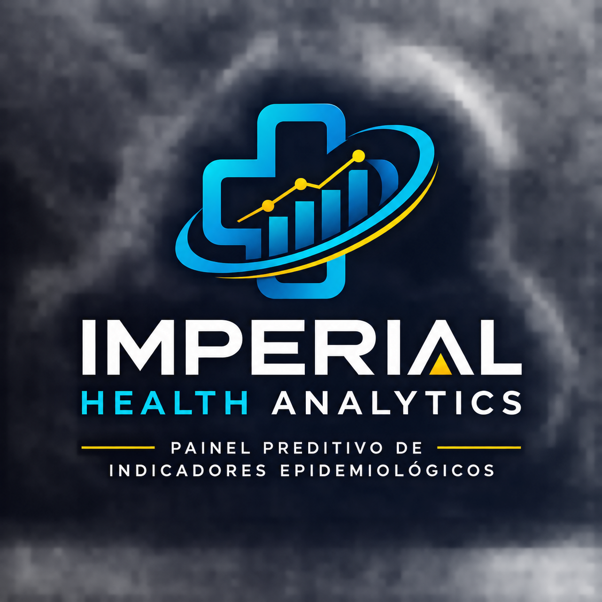

# Imperial Health Analytics - Painel Preditivo de Indicadores Epidemiológicos

  

> **Iniciativa:** FMU Tech Inovação · 1ª Edição 2026.2 (ODS 3 - Saúde e Bem-Estar)  
> **Repositório:** [github.com/gustavolimasilva222-tech/FMU](https://github.com/gustavolimasilva222-tech/FMU)

---

## 1. Descrição do Problema, Público e Contexto
- **Problema de Saúde e Bem-Estar (ODS 3):** Dificuldade no monitoramento epidemiológico preditivo e atrasos na identificação precoce de anomalias em indicadores de saúde pública, gerando sobrecarga hospitalar e tomadas de decisão reativas.
- **Público e Contexto:** Gestores de saúde pública, equipas epidemiológicas e profissionais de saúde que necessitam de previsões analíticas rigorosas e painéis dinâmicos para intervenções preventivas ágeis.
- **Bases de Dados Públicas Utilizadas:** Microdados abertos do DATASUS (SISTAG, SIM/SINASC e bases de vigilância epidemiológica nacional).
- **Título do Projeto:** *Imperial Health Analytics - Painel Preditivo de Indicadores Epidemiológicos*.

---

## 2. Proposta de Solução Tecnológica e Justificativa
- **Abordagem e Funcionamento:** Pipeline analítico em Python para extração de dados públicos, higienização rigorosa, modelagem estatística preditiva de risco epidemiológico e disponibilização de painéis de visualização interativa.
- **Tecnologias Implementadas:** 
  - **Linguagem Principal:** Python 3.x
  - **Bibliotecas / Frameworks:** Pandas, NumPy, Scikit-Learn, SciPy, Matplotlib, Seaborn
  - **Plataforma e Versionamento:** GitHub, Google Colab
- **Justificativa Técnica:** Escolha fundamentada na alta performance do ecossistema Python para tratamento massivo de dados tabulares de saúde, garantindo reprodutibilidade absoluta, escalabilidade e rigor estatístico.

---

## 3. Identidade Visual
- **Logótipo do Projeto:** Emblema institucional integrado à identidade visual técnica do projeto (disponível no diretório `assets/images`).
- **Paleta de Cores Definida:**
  - **Imperial Blue:** `#00B4D8` / `#1D3557` (Cor principal para fluxos e destaque estrutural)
  - **Obsidian Black:** `#05050A` / `#0A1128` (Fundo e tipografia base)
  - **Gold Accent:** `#FFD700` (Insígnias, badges e métricas de alto impacto analítico)
  - **Pure White:** `#FFFFFF` (Contraste e legibilidade em conformidade com as normas)
- **Tipografia Restrita:** Arial / Times New Roman (Alinhamento formal acadêmico e padrão ABNT).

---

## 4. Pitch Inicial (Relevância e Diferencial)
O Imperial Health Analytics eleva a gestão epidemiológica pública ao patamar de excelência técnica. Ao integrar Machine Learning preditivo e painéis visuais automatizados, o sistema substitui a lentidão operativa por insights em tempo real. O grande diferencial reside na capacidade de antecipar riscos populacionais com precisão cirúrgica, otimizando a alocação de recursos e salvando vidas através de decisões baseadas em dados concretos.

---

## 5. Integrantes do Grupo
- **Gustavo Lima Silva** (RA: 2025203029) — *Embaixador / Ciência de Dados* (`gustavo.lima.silva222@gmail.com`)
- **Thiago Araújo Linhares Fidelis** (RA: 2025200106) — *Ciência de Dados*
- **Juan Luccas Gomes Razzano** (RA: 2026108904) — *Ciência de Dados*
- **Melany Kauane Souza Inácio** (RA: 2026207101) — *Ciência de Dados*
- **Rodrigo Viana Camilo** (RA: 2025205319) — *Ciência de Dados*
